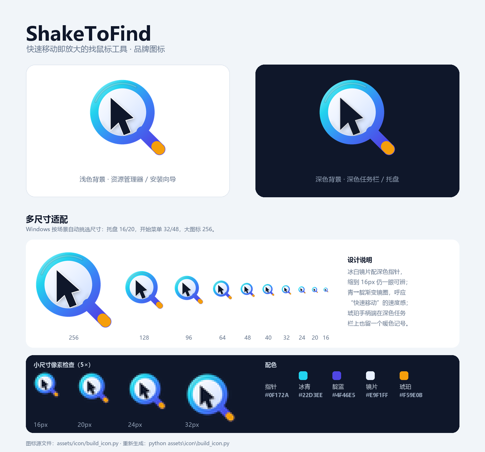

简体中文 | [English](README.en.md)

# ShakeToFind —— 快速移动就放大指针（越快越大）

[](https://github.com/WenKaiYang/ShakeToFind/releases)
[](https://www.autohotkey.com/)
[](LICENSE)
[](https://github.com/WenKaiYang/ShakeToFind/releases/latest)
[](https://github.com/WenKaiYang/ShakeToFind/releases)

> **找鼠标 / 找光标 / 鼠标放大 / 光标放大 / 鼠标指针变大 / 丢失鼠标位置 / 屏幕太小看不清光标 / 找不到鼠标箭头 / cursor finder / enlarge cursor / magnify mouse pointer**
>
> Windows 上「鼠标指针找不到 / 看不清 / 想让光标更大」的轻量解决方案。鼠标移动得越快，指针放大得越多。



Windows 版「找鼠标」工具：鼠标移动速度超过正常速度后，指针开始放大；**速度越快放大倍数越大**，慢下来按速度连续缩小，最终恢复原大小。

## 为什么需要它

- **双屏 / 大屏 / 投影**：光标在不同分辨率的屏幕之间穿梭，容易「丢失」。
- **笔记本触控板 + 外接显示器**：缩放比例不同，光标在小屏上小得几乎看不见。
- **演示 / 录屏 / 教学**：远处的观众看不清你指向哪里。
- **给老人 / 视力不佳者**：把光标放大到 4–6 倍，看得清点击位置。

## 效果

- 慢速移动 / 停住：正常大小，不干扰。
- 速度超过 2500 像素/秒：开始放大（约 1.8 倍）。
- 达到 6000 像素/秒：放大到最大 6 倍。
- 中间速度按比例连续变化，快变大、慢变小，平滑过渡。
- 放大的光标实时跟随鼠标；显示期间每 5ms 更新一次，比平时更跟手。
- 跟随过程中会自动同步当前光标形状（箭头 / I 型 / 手型）。
- 覆盖层鼠标穿透、不抢焦点，不影响点击。

## 特性

| | |
| --- | --- |
| 🖱️ | 速度驱动放大：越快越大，慢下来自动恢复 |
| 🪟 | 穿透覆盖层：不抢焦点、不挡点击、鼠标可穿透 |
| 🔄 | 实时同步光标形状（箭头 / I 型 / 手型） |
| 🪶 | 轻量：单文件 AutoHotkey 脚本，绿色安装、干净卸载 |
| 🔒 | 无需管理员权限，装在 `%LOCALAPPDATA%`，不写系统目录 |
| 🌐 | 纯本地运行，**不联网、不收集任何数据** |
| 🎨 | 自带品牌图标，安装包 / 快捷方式 / 托盘图标一致 |
| ⚙️ | 灵敏度、放大倍数等参数可在脚本顶部直接改 |

## 与 macOS 的对比

| 维度 | macOS | 本工具 |
| --- | --- | --- |
| 触发方式 | 摇一摇 | 按移动速度（本工具设计） |
| 放大规则 | 固定倍数 | 随速度连续变化（本工具设计） |
| 跟随 | 系统直接渲染，零延迟 | 覆盖层跟随，约 5ms 更新（仍有极短延迟） |
| 渲染 | 系统级平滑缩放、真透明 | GDI 位图放大 + HALFTONE 平滑 + 颜色键透明 |
| 光标形状 | 永远是当前真实光标 | 已实时同步 |
| 热点 / 点击穿透 | 一致 | 一致 |

macOS 是在系统层面直接放大光标本身，Windows 没有对应接口，因此这里用「穿透覆盖层 + 实时跟随」来逼近；缩放边缘为位图放大，仍不如系统渲染锐利。

## 下载安装

从 [Releases](https://github.com/WenKaiYang/ShakeToFind/releases) 下载最新安装包 `ShakeToFind-Setup-<版本>.exe`：

- 安装到 `%LOCALAPPDATA%\Programs\ShakeToFind`，**无需管理员权限**。
- 默认勾选「开机自动启动」，可在安装向导的「附加任务」里取消。
- 卸载：Windows 设置 → 应用 → ShakeToFind → 卸载（或开始菜单里的 Uninstall ShakeToFind）。
- 迁移：把安装包复制到其他电脑直接运行即可。

> 安装包未做代码签名，首次运行可能出现 SmartScreen 提示，点「更多信息」→「仍要运行」。

## 使用

- 安装包默认设置开机自启：`%APPDATA%\Microsoft\Windows\Start Menu\Programs\Startup\ShakeToFind.lnk`
- 退出：托盘区 ShakeToFind 图标（放大镜）右键 → Exit。
- 修改脚本后：托盘区 ShakeToFind 图标右键 → Reload。
- 预览放大效果（安装版）：

```powershell
& "$env:LOCALAPPDATA\Programs\ShakeToFind\AutoHotkey64.exe" "$env:LOCALAPPDATA\Programs\ShakeToFind\ShakeToFind.ahk" --demo
```

## 常见问题

**Q：和 macOS 上「摇晃放大鼠标」有什么区别？**
A：macOS 是系统级功能，摇一摇触发、固定倍数。本工具是 Windows 下的替代方案，按移动速度连续变化：越快越大。同时它对双屏 / 缩放比例不一致的场景更实用。

**Q：会干扰我正常点击吗？**
A：不会。放大层是鼠标穿透、不抢焦点的覆盖层，只有鼠标移动足够快时才出现，且完全跟随真实指针位置。

**Q：安全吗？会不会上传我的信息？**
A：不会。全部逻辑在本地 `ShakeToFind.ahk` 一个文件里，无网络请求、无数据收集。安装包自带 AutoHotkey v2 运行时，目标电脑无需预装任何东西。

**Q：会不会和别的鼠标软件冲突？**
A：它只读取鼠标位置并绘制一个覆盖层，不Hook、不注入、不接管输入，一般不会冲突。同时开多个此类工具时可能互相遮挡，建议只留一个。

**Q：为什么放大后的边缘不如系统渲染锐利？**
A：Windows 没有提供系统级的光标缩放接口，这里用 GDI 位图放大 + HALFTONE 平滑来逼近 macOS 的观感，所以边缘略有锯齿。

**Q：怎么让它更灵敏 / 更夸张？**
A：见下方「调整灵敏度 / 外观」。

## 同类工具

| 工具 | 平台 | 做法 | 特点 |
| --- | --- | --- | --- |
| **ShakeToFind**（本项目） | Windows | 按移动速度连续放大 | 速度越快越大，透明穿透，绿色安装 |
| macOS 摇晃放大 | macOS | 系统级摇一摇 | 系统渲染，最锐利，零延迟 |
| Windows 放大镜 | Windows | 系统自带 Magnifier | 放大整个屏幕，功能更重 |
| PointerFocus | Windows | 定时闪烁鼠标指针 | 靠闪烁提醒，不放大 |
| Crosshair | 跨平台 | 屏幕中央显示准星 | 适合固定位置精细操作 |

## 调整灵敏度 / 外观

用记事本打开 `ShakeToFind.ahk`，改顶部的参数并保存，然后 Reload：

| 参数 | 默认 | 说明 |
| --- | --- | --- |
| `SPEED_WINDOW` | 120 | 测速窗口（毫秒） |
| `SPEED_MIN` | 2500 | 超过该速度（像素/秒）才开始放大，调小更灵敏 |
| `SPEED_FULL` | 6000 | 达到该速度时放大到最大倍数，调小更易到最大 |
| `SCALE_MIN` | 1.8 | 刚超过阈值时的放大倍数 |
| `SCALE_MAX` | 6.0 | 最大放大倍数 |
| `SCALE_SMOOTH` | 0.35 | 大小变化平滑系数（0~1，越大越跟手） |
| `DEBUG` | false | true 时把速度/倍数记录到 `trigger.log` |

> 觉得太容易触发就调高 `SPEED_MIN`（如 3500）；觉得甩得很快还不出现就调低（如 1500）。
> 想更夸张就把 `SCALE_MAX` 调到 8，嫌太大调到 4。

## 图标

安装包、开始菜单 / 开机启动快捷方式、卸载项和托盘图标共用同一枚品牌图标 `assets\icon\ShakeToFind.ico`（16–256 共 10 个尺寸）。

图案是「放大镜 + 放大的指针」：放大镜代表“找鼠标”，镜片里的指针代表“会变大的指针”；冰白镜片保证缩到 16px 也看得清，青→靛渐变的镜圈和琥珀色手柄端是它的辨识点。

想改配色或形状，编辑 `assets\icon\build_icon.py`（需要 Python + Pillow）后重新生成：

```powershell
python assets\icon\build_icon.py
```

它会重写 `assets\icon\ShakeToFind.ico` 和预览图 `assets\icon\preview.png`；再执行 `.\build.cmd` 重新打包即可。

## 项目结构

- `ShakeToFind.ahk` —— 主脚本（源码）
- `build.cmd` —— 一键打包命令
- `assets\icon\` —— 品牌图标：生成脚本 `build_icon.py`、多尺寸 `ShakeToFind.ico`、预览图 `preview.png`
- `installer\` —— Inno Setup 打包脚本与构建说明
- `dist\` —— 本地构建产物（不提交到仓库）

安装后位于 `%LOCALAPPDATA%\Programs\ShakeToFind\`，包含脚本、便携版 AutoHotkey v2 和 `license.txt`。

## 开发 / 构建

在项目根目录执行一条命令即可打包：

```powershell
.\build.cmd            # 使用 installer\ShakeToFind.iss 中的默认版本
.\build.cmd 1.0.1      # 指定版本号
```

产物在 `dist\ShakeToFind-Setup-<版本>.exe`。

首次构建需要安装 [Inno Setup 6](https://jrsoftware.org/isdl.php)，并把 AutoHotkey v2 便携版放进 `installer\payload\`，详见 `installer/BUILD.md`。

> PowerShell 中要写 `.\build.cmd`；cmd 中直接输入 `build.cmd` 即可。

## 参与贡献

欢迎提 Issue 和 PR！贡献前请读 [CONTRIBUTING.md](CONTRIBUTING.md)。

## 第三方组件

- AutoHotkey v2（GPLv2），许可文本随安装包分发（`license.txt`）。

## 许可

本项目采用 [MIT 许可](LICENSE)。随包分发的 AutoHotkey v2 遵循其自身的 GPLv2 许可。

## 关闭开机自启

删除启动文件夹里的 `ShakeToFind.lnk` 即可：

```powershell
Remove-Item "$env:APPDATA%\Microsoft\Windows\Start Menu\Programs\Startup\ShakeToFind.lnk"
```
